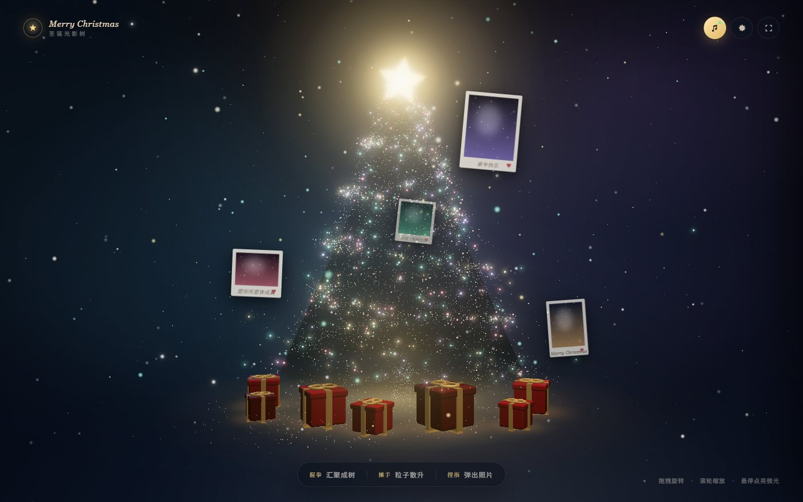
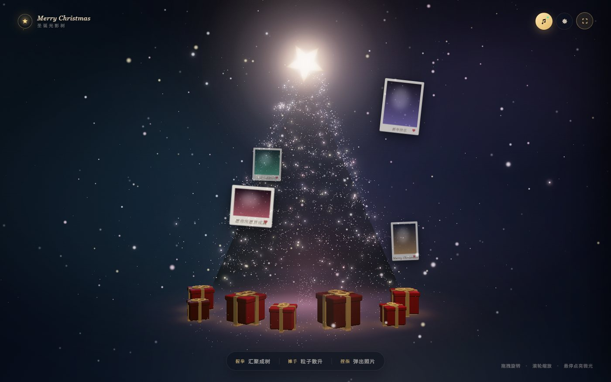

# 圣诞光影树 · Gesture Christmas Tree

伸手，就能拥有一棵圣诞树。

一颗由九千粒星光组成的粒子圣诞树：摄像头识别手掌，**握拳汇聚成树、摊手粒子散升、捏指弹出照片**。照片、音乐、粒子与礼盒样式全部可自定义；照片会缓存在浏览器里，下次用同一个浏览器打开仍在。

- 在线预览（GitHub Pages）：<https://vixzelq.github.io/christmas-tree/>
- 仓库：<https://github.com/nobody-r/christmas-tree.git>



<p align="center">
  
  &nbsp;&nbsp;
  
</p>

---

## 一分钟本地预览

摄像头只在 **HTTPS 或 localhost** 下可用，所以请用本地服务器打开，不要直接双击 `index.html`。

```bash
cd christmas-tree
node serve.mjs           # 打开 http://127.0.0.1:8080
# 或者：python -m http.server 8080
```

首次开启摄像头时，会在本地加载手势模型（约 8 MB），需要几秒钟。

### 让预览常驻（开机自动启动）

- 双击 `start-preview.vbs`：后台启动，地址 <http://127.0.0.1:8756/>
- 开机自启：`XmasTreePreview.vbs` 已放进 Windows 启动文件夹，登录后自动运行
- 停止：双击 `stop-preview.cmd`
- 电脑关机或注销期间无法访问；该地址只对本机有效

## 功能

| 手势 | 效果 |
| --- | --- |
| ✊ 握拳 | 星尘向你聚拢，汇成一棵圣诞树；保持握拳时左右/上下移动手掌，可以旋转圣诞树 |
| 🖐 摊手 | 树散作星尘，缓缓上升、飘向夜空 |
| 🤏 捏指 | 出现一枚虚拟光标；把光标移到树上的照片，停留约 0.4 秒，照片会从卡片位置飞出来放大；再捏指切换下一张 |
| ☝️ 一指 | 粒子配色与礼盒样式一起切换（金辉 / 极光 / 玫瑰 / 冰晶） |
| ✌️ 两指 | 开始下雪，再比一次就停雪 |
| 🤟 三指 | 开始放烟花，再比一次就结束 |

所有手势都在页面右侧的「手势」侧栏里有说明，当前识别到的手势会高亮。

其它能力：

- **自定义相片**：最多 12 张，支持拖拽或选择文件；自动压缩、生成缩略图，保存在浏览器 IndexedDB 中，刷新/重开浏览器仍在。照片展示 5 秒后自动关闭，把光标移到另一张、再捏指就能打开那一张。
- **自定义音乐**：内置两首合成颂歌（《铃儿响叮当》《平安夜》，Web Audio 实时合成，无需音频文件），也可以上传 MP3 / M4A / WAV，同样会缓存。
- **粒子随音乐律动**：频谱分析驱动粒子亮度、树身呼吸、光晕强度、礼盒弹跳与星星脉冲。
- **4 套粒子配色**：金辉圣诞 / 极光雪松 / 玫瑰颂歌 / 冰晶幻境。
- **4 套礼盒样式**：红金经典 / 翡翠丝带 / 粉雪马卡龙 / 冰蓝星尘。
- **4 种相框样式**：宝丽来 / 金边 / 极光玻璃 / 花环暗纹。
- **飘雪、烟花、星星光晕、Bloom 后处理**，以及手机竖屏适配。
- 树后有一行巨大的 `Merry Christmas` 英文字样，随极光一起呼吸。

### 鼠标 / 键盘（没有摄像头也能玩）

| 操作 | 功能 |
| --- | --- |
| 空格 | 汇聚 / 散开 |
| P | 弹出照片 |
| M | 音乐开关 |
| S | 下雪 / 停雪 |
| X | 烟花 / 停止 |
| G | 打开设置 |
| F | 全屏 |
| 拖拽 / 滚轮 | 旋转 / 缩放 |
| Esc | 关闭照片或设置 |

## 部署到 GitHub Pages

这个项目是纯静态站点，不需要构建：

1. 把本目录下的所有文件（`index.html`、`css/`、`js/`、`vendor/`、`assets/` 等）推送到仓库根目录；
2. GitHub 仓库 **Settings → Pages**，Source 选择 `Deploy from a branch`，分支 `main`、目录 `/ (root)`；
3. 等待一两分钟，访问 `https://<用户名>.github.io/christmas-tree/`。

```bash
# 如果你本地有 git
git add .
git commit -m "feat: gesture christmas tree"
git push origin main
```

`.nojekyll` 已包含在项目里，告诉 GitHub Pages 跳过 Jekyll 处理。

> 如果仓库里还留着旧的打包产物（`assets/`、`audio/`、`mediapipe/hands/` 等），现在可以删掉，新版本已经不再需要它们。

> 摄像头需要 HTTPS：GitHub Pages 默认就是 HTTPS，没有问题。

## 目录结构

```
christmas-tree/
├── index.html              # 页面骨架与文案
├── css/style.css           # 视觉系统、面板、照片框、开场
├── js/
│   ├── main.js             # 场景编排、状态机、交互、启动
│   ├── tree.js             # 粒子圣诞树（含树体、星星、雪堆、地面光池）
│   ├── gifts.js            # 3D 礼盒与缎带蝴蝶结
│   ├── photos.js           # 挂在树上的照片卡片 + 捏指弹出层
│   ├── gestures.js         # 摄像头 + MediaPipe HandLandmarker
│   ├── gesture-math.js     # 手势判定（纯函数，可单测）
│   ├── audio.js            # Web Audio 合成颂歌 / 自定义音频 / 频谱分析
│   ├── snowfall.js         # 2D 飘雪
│   ├── store.js            # IndexedDB 持久化（照片 / 音乐 / 设置）
│   ├── ui.js               # 设置面板、照片墙、手势 HUD、Toast
│   ├── config.js           # 调色板、礼盒、默认设置
│   └── utils.js            # 工具函数与贴图生成
├── vendor/
│   ├── three/              # three.js r187 + Bloom 后处理（本地化，离线可用）
│   └── mediapipe/          # tasks-vision wasm（本地化）
├── assets/hand_landmarker.task   # 手部关键点模型（本地化）
├── serve.mjs               # 零依赖静态服务器
└── .nojekyll
```

所有第三方依赖都已放进仓库，**不依赖任何 CDN**，国内网络也能正常加载。

## 别人也能用吗

可以，而且不用注册：

- 任何人打开站点，都能添加自己的照片、换配色、放烟花，做一棵自己的树。照片只存在各自的浏览器里，互不影响。
- 想拥有一个完全独立的站点：Fork 这个仓库 → 开启 Pages 即可。

## 手势怎么调得更准

设置 → 手势：

- **识别灵敏度**：越高越灵敏（更容易触发），越低越稳（需要更明确的手势）。
- 手离摄像头 40–80 cm，手掌正对镜头，光线均匀时最稳。
- 手势需要连续 4 帧一致才会切换，避免抖动误触。
- 摊手时手指尽量伸直；握拳时手指完全收进掌心；捏指时只用拇指和食指相触。

判定逻辑在 `js/gesture-math.js`：先用指节夹角 + 指尖到手腕的距离判断每根手指的伸直程度，再结合拇指与食指的距离（按手掌大小归一化）判定捏合，最后交给多数表决稳定器。

## 数据与隐私

- 摄像头画面只在浏览器本地用 WebAssembly 分析，**不上传、不录制、不落盘**。
- 照片与音乐以 Blob 形式存进 IndexedDB（库名 `xmas-light-tree`），设置同时写入 localStorage 作为快速启动缓存。
- 清空照片：设置 → 照片 → 清空全部照片。
- 换浏览器或清除站点数据后需要重新添加照片。

## 浏览器支持

- Chrome / Edge 100+、Safari 16.4+、Firefox 110+（需要 WebGL2 与 Web Audio）。
- 手势识别需要 `getUserMedia`：仅 HTTPS 或 localhost。
- 手机上如果摄像头不可用，可以用底部按钮或空格键控制。

## 技术栈

- [three.js](https://threejs.org/) r187：粒子、礼盒、Bloom 后处理
- [MediaPipe Tasks Vision](https://developers.google.com/mediapipe)：手部 21 关键点
- Web Audio API：合成颂歌、频谱分析与节拍检测
- IndexedDB：照片 / 音乐 / 设置持久化
- 原生 ES Modules，无构建步骤

## 常见问题

**打开是黑屏？**
请通过 HTTP 服务器访问（`node serve.mjs`），而不是 `file://`。ES Modules 与 importmap 在 `file://` 下会被浏览器拦截。

**摄像头打不开？**
检查地址栏的摄像头权限；确认页面是 HTTPS / localhost；关掉占用摄像头的其它程序（会议软件等）。

**没有声音？**
浏览器要求用户交互后才能播放音频：点一下右上角音符按钮，或重新进入页面。手机静音开关也会影响声音。

**照片刷新后没了？**
照片存在当前浏览器的 IndexedDB 里。无痕模式、清除站点数据、换浏览器都会丢失。

**手势识别不到？**
先看左下角预览里有没有画出手部骨架。没有的话调整光线和距离；有骨架但状态不变，就把「识别灵敏度」调高一些。

---

Made with starlight & memories · 2026
